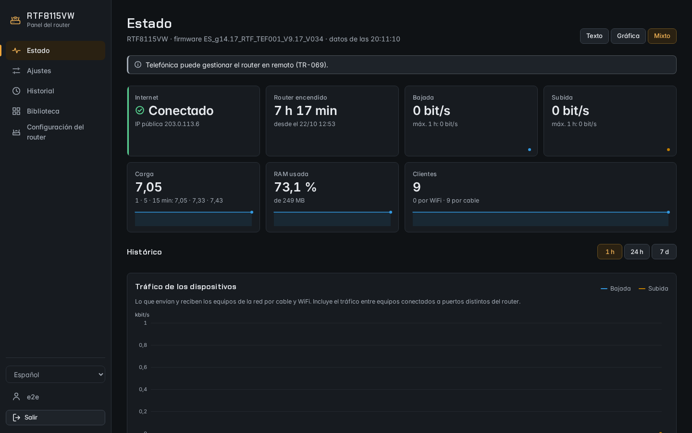
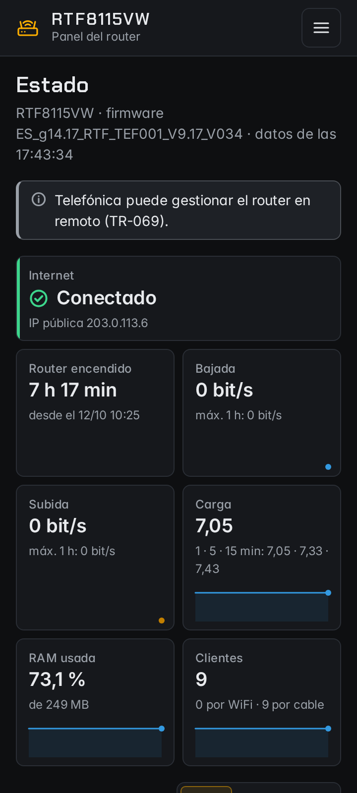
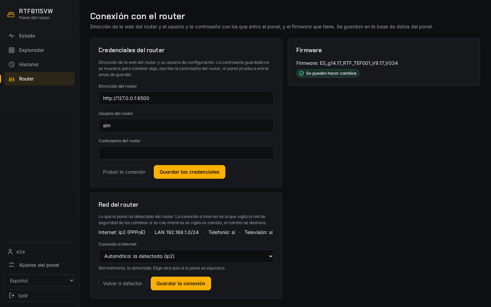
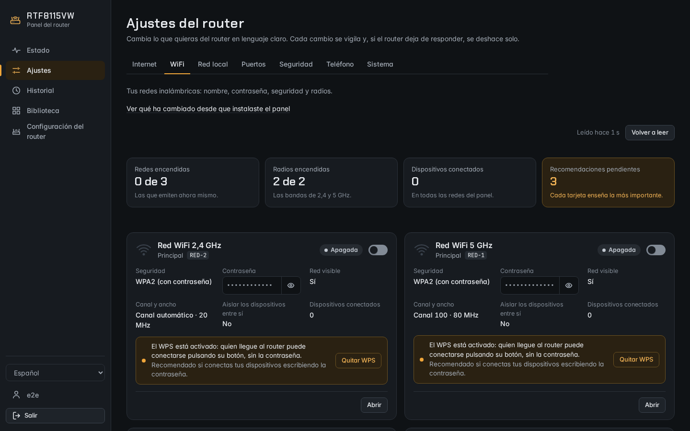
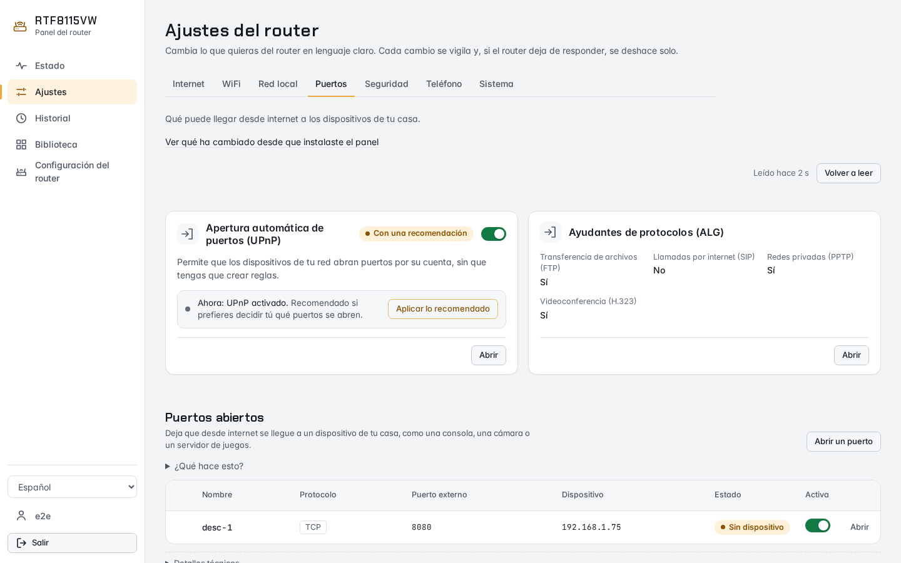
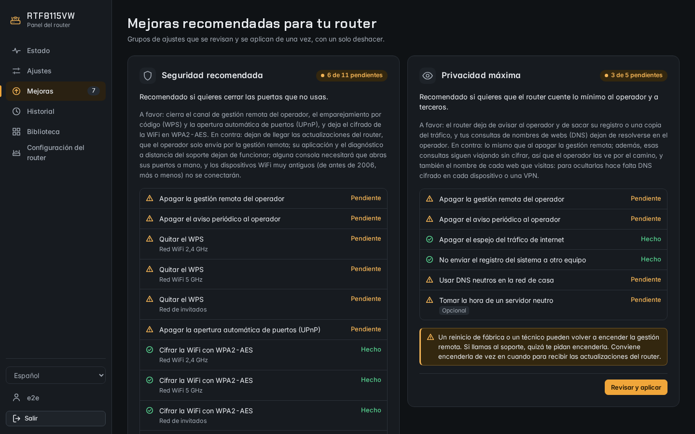

# RTF8115VW router panel

*[Español](README.md)*

Web panel for the Askey RTF8115VW router that Movistar and O2 install in
Spain. It runs on a machine in your network (a server, a Raspberry Pi, a
container) and talks to the router's web interface:

- **Status**: internet connection, uptime, traffic, load, RAM and clients,
  with 1 h, 24 h and 7 day charts and warnings (TR-069 remote management,
  WPS…).
- **Settings**: the router's settings grouped by topic (Internet, WiFi, Home
  network, Ports, Security, Phone and System) and explained in plain
  language: what each one does, what happens when you change it, its risk
  and the recommended value, with who it is for, pros and cons. At a glance
  you see what is on, what needs your attention and what the panel
  recommends; things are switched on or off with a toggle, and you can act
  on several items at once, with a single undo.
- **Improvements**: two batches of settings, "Recommended security" and
  "Maximum privacy", reviewed and applied in one go, with a single undo; the
  sidebar counts what is left.
- **Library**: every function of the router's API, with its description.
  Changes are **watched**: if the router stops answering or internet goes
  down, they are undone on their own.
- **History** of everything changed, with undo.
- Its own users and passwords, in Spanish and English, light or dark theme,
  and usable on a phone.

Independent project, not affiliated with Telefónica, Movistar, O2 or Askey:
read the [legal notice](AVISO-LEGAL.md#legal-notice) before using it.

## Screenshots

| Status | On a phone | Router connection |
|---|---|---|
|  |  |  |

| Settings: WiFi | Settings: Ports, light theme | Improvements |
|---|---|---|
|  |  |  |

Taken with the simulated router and made-up data, and in Spanish, the
panel's default language (the language selector switches it to English).
They are regenerated with `npx playwright test capturas-readme` (in `e2e/`,
see [Checks](#checks)).

## Tested router and firmware

| Model | Firmware |
|---|---|
| Askey RTF8115VW | `ES_g14.17_RTF_TEF001_V9.17_V034` |

With any other firmware the panel starts **read-only**: it shows the status
and reads, but changes nothing. If everything looks right, confirm it in
"Router settings → Router connection" and report it in an issue on the
repository (model, firmware and what you tried) so it can be added to the
list.

## What it detects and what you configure

When it connects, the panel **detects** from the router: model and firmware;
which connection carries internet and its type; the local network and the
router's address in it; whether there is telephony and TV; and which WiFi
radios it has.

You **configure**:

- in the installation wizard, the first user and the router credentials
  (stored encrypted);
- in "Router settings → Router connection", the credentials, the firmware
  confirmation and, if detection gets it wrong, which connection is the
  internet one;
- in "Panel settings", the default language and time zone, your display
  mode, your theme (automatic, following the system, dark or light) and the
  users.

The router settings are changed in "Settings" (`/ajustes/<topic>`), with no
API names in sight: change the WiFi password, turn off WPS, fix a device's
IP, open a port or turn off the operator's remote management (TR-069). Each
topic says when it read the router, with "Read again":

- **WiFi, Internet, Security, Phone and System** start with a summary strip
  (pending recommendations in amber) and show a grid of cards: each with its
  status (green if it is on and broadcasting, grey if it is off), its
  toggle, its main data and its recommendation. Opening one unfolds its
  fields below it, full width.
- **Ports** (the rules) and **Home network** (fixed IPs and devices) are
  lists with columns, sortable by column and, with more than eight rows,
  filterable; opening a row slides its detail in from the right. The
  settings that are not lists, such as UPnP or DHCP, are cards above them.
- You can mark several cards or rows (a circle that shows on hover) and a
  bar offers what can be done with all of them: one change with one undo.
  Each open item has its own address (`/ajustes/<topic>/<item>`), and they
  can be browsed with the keyboard.
- Turning off something that cuts people off (a WiFi network with connected
  devices) asks first; the rest applies straight away, with "Undo" in the
  notice.

Before saving some fields, a summary shows what changes ("before → after");
afterwards the change is watched and can be undone from the summary itself
or from the History. "How it was at installation" compares the router with
the snapshot the wizard took and lets you go back to any setting. Passwords
are masked, with an eye to reveal them; everything else is shown in clear.
Whatever is not in Settings is changed from the Library, also with
watching.

### Improvements

"Improvements" (`/mejoras`) gathers in two batches the settings worth
changing and says, for each, who it is for, what you gain and what you
lose:

- **Recommended security**: turns off the operator's remote management
  (TR-069) and its regular check-in, WPS on each WiFi network, automatic
  port opening (UPnP), the traffic mirror and sending the system log to
  another machine; leaves each WiFi network on WPA2-AES and isolates the
  guest network if it is on. It also carries some tips without a button,
  for what the router does not let you change from its web interface.
- **Maximum privacy**: turns off remote management, its check-in, the mirror
  and sending the log; hands out neutral DNS servers to the home network,
  with a choice of provider (Quad9, Quad9 unfiltered, DNS4EU, Cloudflare or
  AdGuard), and, if you tick it, takes the time from a neutral server.

Each card says which steps are done, which are left and which could not be
read, and the sidebar counts the pending ones. "Review and apply" opens the
review with the steps by tab, each with its "before → after" and its
checkbox; it is applied as a single change, watched and with a single
undo. In Settings, a recommendation that is part of a batch says so and
links to Improvements.

Neutral DNS servers only change who answers: the router hands them out
and each device asks them directly, but unencrypted, so the operator can
still see the queries on the way. To
hide them you need encrypted DNS (DoH or DoT) on each device or a VPN.

The batches have been tested against the simulated router (`router-sim`);
checking them on the real router is a separate step (TV and phone with
TR-069 off, which DHCP pool the set-top box uses, the system log…). Until
then, apply them knowing that "Undo" brings everything back.

## Installation

Three ways, each with its guide ([`deploy/README.md`](deploy/README.md), in
Spanish):

- **Linux with systemd** ([`deploy/linux/`](deploy/linux/README.md)):
  prebuilt releases for x86_64 and aarch64 that need glibc 2.35 or later
  (Debian 12, Ubuntu 22.04, 64-bit Raspberry Pi OS or newer). Each release
  ships `SHA256SUMS` and, optionally, its minisign signature; the optional
  updater checks both.
- **Docker or Podman** ([`deploy/docker/`](deploy/docker/README.md)): Compose
  with the panel and an example Caddy proxy.
- **FreeBSD jails** ([`deploy/freebsd-jail/`](deploy/freebsd-jail/README.md)):
  builds from source (there are no FreeBSD releases) in a separate jail and
  updates itself with each tag.

The first time, you finish in the browser with the installation wizard;
day-to-day operation (users, backups, logs, updating) is in
[`docs/operacion.md`](docs/operacion.md).

### HTTPS and reverse proxy

The panel does not speak HTTPS itself and **needs an HTTPS reverse proxy** in
front (Caddy, nginx…), limited to the local network, that passes it the
client IP in `X-Forwarded-For`. Without HTTPS the browser does not keep the
session. Examples and details: [`docs/proxy-tls.md`](docs/proxy-tls.md).

## Configuration (`RP_*`)

The panel's environment variables (`crates/panel/src/config.rs`):

| Variable | Default | What it is |
|---|---|---|
| `RP_ORIGIN` | none: **required** | the panel's address as the browser types it (`https://panel.home.arpa`); several, separated by commas |
| `RP_LISTEN` | `127.0.0.1:3000` | address and port it listens on (HTTP, behind the proxy) |
| `RP_TRUSTED_PROXY` | `127.0.0.1` | IPs or networks of the proxies trusted for `X-Forwarded-For`, separated by commas |
| `RP_DB` | Linux: `/var/lib/routerpanel/panel.db`; FreeBSD: `/var/db/routerpanel/panel.db` | SQLite database (users, encrypted credentials, history) |
| `RP_HISTORY_KEY` | Linux: `/etc/routerpanel/history.key`; FreeBSD: `/usr/local/etc/routerpanel/history.key` | master key that encrypts the credentials and secrets; the panel creates it |
| `RP_INSTALL_NETS` | empty | networks from which, besides the local network, the installation wizard answers |
| `RP_LOG` | `info` | log level (`tracing`'s `EnvFilter` syntax) |
| `RP_ROUTER_URL`, `RP_ROUTER_USER`, `RP_ROUTER_SECRET` | empty | only for installations older than the wizard: address, user and file (600) with the router password, imported once into the database. All three or none |

Also, when you start the binary by hand, Leptos's ones for the web:
`LEPTOS_SITE_ROOT` (the `site/` folder), `LEPTOS_SITE_PKG_DIR=pkg`,
`LEPTOS_OUTPUT_NAME=panel` and `LEPTOS_SITE_ADDR` (same as `RP_LISTEN`). The
installation guides already set them.

## Building

- Rust: the version pinned in [`rust-toolchain.toml`](rust-toolchain.toml)
  (with `rustup`, it installs itself with its `wasm32-unknown-unknown`
  target).
- `cargo-leptos` 0.3.11: `cargo install --locked cargo-leptos --version 0.3.11`.
- `wasm-bindgen-cli`, **the same version** as `wasm-bindgen` in `Cargo.lock`:
  `cargo install --locked wasm-bindgen-cli --version <version from Cargo.lock>`.
- `binaryen` (`wasm-opt`), from the system package manager.

```sh
cargo leptos build --release   # target/release/panel and target/site/
```

## Development without a router

`router-sim` is a simulated router built from captured and sanitised
responses (`crates/hgu/fixtures`): it lets you try the panel without touching
a real router.

```sh
cargo run -p router-sim                     # simulated router on 127.0.0.1:8081 (user and password: sim)
mkdir -p /tmp/panel
RP_LISTEN=127.0.0.1:3000 RP_DB=/tmp/panel/panel.db RP_HISTORY_KEY=/tmp/panel/history.key \
RP_TRUSTED_PROXY=127.0.0.1 RP_ORIGIN=http://localhost:3000 cargo leptos watch
```

Open `http://localhost:3000` (not `127.0.0.1`: the `__Host-rp_session`
cookie is `Secure` and the browser only accepts it over http on
`localhost`). With no users, the panel opens the installation wizard
(`/instalar`): the token is in the log and in `/tmp/panel/instalar.token`;
the router is `http://127.0.0.1:8081`, user and password `sim`.

## Layout

| Path | What it is |
|---|---|
| `crates/hgu` | router client: session, reads and writes, a single mutex and 150 ms between requests; network detection; sanitised captures in `fixtures/` |
| `crates/ajustes` | Settings catalogue (`ajustes/<topic>.toml`): each setting with its fields, the items of each topic and the router functions it reads and writes |
| `crates/catalogo` | reviewed catalogue of functions (`funciones.toml`: risk, blocked, paired reads) and secrets that are masked (`secretos.toml`) |
| `crates/panel` | server and web (SSR + hydration), installation wizard, authentication, polling, watched changes, history, settings; CLI `panel user add` and `panel user passwd` |
| `crates/i18n` | interface texts in Spanish and English (Fluent, `locales/{es,en}`) |
| `crates/router-sim` | simulated router for tests and development; `sanear-fixtures` |
| `tools/gen-catalogo` | generates the catalogue draft and [`docs/api.md`](docs/api.md) |
| `tools/comprobar-publicacion` | checks that no personal or home-network data gets published |
| `e2e/` | browser tests (Playwright) against the simulator |
| `deploy/` | the three ways to install ([`deploy/README.md`](deploy/README.md)) |
| `docs/` | [`api.md`](docs/api.md) (router API), [`funciones-del-panel.md`](docs/funciones-del-panel.md) (the panel functions for Settings, History and the router password, in Spanish), [`operacion.md`](docs/operacion.md) (day to day), [`proxy-tls.md`](docs/proxy-tls.md) (HTTPS and proxy) |

The code, its comments and the documentation in `docs/` and `deploy/` are in
Spanish.

## Checks

```sh
cargo fmt --all --check
cargo clippy --workspace --all-targets -- -D warnings
cargo clippy -p panel --all-targets --features ssr -- -D warnings
cargo clippy -p panel --lib --target wasm32-unknown-unknown --no-default-features --features hydrate -- -D warnings
# Tests with cargo-nextest (cargo install --locked cargo-nextest), which
# runs each test in its own process; profiles in .config/nextest.toml.
# Without it, cargo test --workspace [--features panel/ssr] tests the same,
# more slowly.
cargo nextest run --workspace
cargo nextest run --workspace --features panel/ssr
cargo test --doc --workspace --features panel/ssr   # nextest does not run doctests
cargo audit          # justified exceptions in .cargo/audit.toml
cargo deny check     # deny.toml
cargo run -q -p comprobar-publicacion -- --arbol . --sin-locales

# Browser: wizard, languages, Settings, no horizontal overflow at 360 px;
# screenshots in e2e/capturas/. `cargo leptos build` goes last (see below).
cargo build -p router-sim
cargo build -p panel --features ssr --example e2e_grupo
cargo leptos build
cd e2e && npm ci && npx playwright test
npx playwright test capturas-readme   # only if the README screenshots change
```

The e2e run spreads the files over `E2E_WORKERS` workers (by default, one per
3 CPU threads, between 1 and 2; 4 on a dedicated machine; at most 10;
`E2E_WORKERS=1` runs them one after another). It starts one installed panel
per worker, four freshly installed ones for the setup wizard, two for the
Settings walkthrough (one per language), two for the WiFi grid, one for the
other grid tabs and one for Improvements, each with its own simulator
(`e2e/instancias.ts`), on consecutive ports from `E2E_PORT` and
`E2E_SIM_PORT` (3195 and 8195; with 4 workers, 3195–3208 and 8195–8208). Each
change is watched for 10 s instead of 30 s or 2 min (`RP_E2E_VIGILANCIA_S`,
honoured only by the debug build). It uses Playwright's Chromium
(`npx playwright install chromium` if missing; or `E2E_CHROMIUM=<path>`).

The e2e run uses the `target/debug/panel` from `cargo leptos build`, which is
compiled like the wasm (with `--cfg erase_components`). `cargo test` and
`cargo nextest` with `--features panel/ssr` leave a different binary in the
same place, whose HTML the wasm does not hydrate: if it finds that one, the
e2e run stops with "ejecuta `cargo leptos build`" (run `cargo leptos build`).
That is why `cargo leptos build` goes last, after the tests.

The README screenshots are saved in `docs/capturas/` without metadata. After
regenerating them, review them by hand (nothing real must show) and put their
new sha256 in `tools/publicacion-permitidos.txt`.

## Contributing

Before your first `git push`, enable the hook that checks what is pushed:

```sh
git config core.hooksPath tools/hooks
```

`pre-push` runs `comprobar-publicacion` over everything that goes out: MACs,
IPs and domains that are not documentation ones and, besides, the
maintainer's local lists of their own data (which are not in the
repository). By default the hook requires those lists and pushes nothing
without them; if you are not the maintainer, turn them off in your clone (it
only counts in its `.git/config`, and the hook warns on every push):

```sh
git config routerpanel.sinListas true
```

The generic checks stay on. Use documentation addresses in examples and
tests (`192.0.2.x`, `*.example`, `*.home.arpa`) and sanitise router captures
with `tools/sanear-fixtures.sh`.

## Licence

[MIT](LICENSE). See also the [legal notice](AVISO-LEGAL.md#legal-notice).
